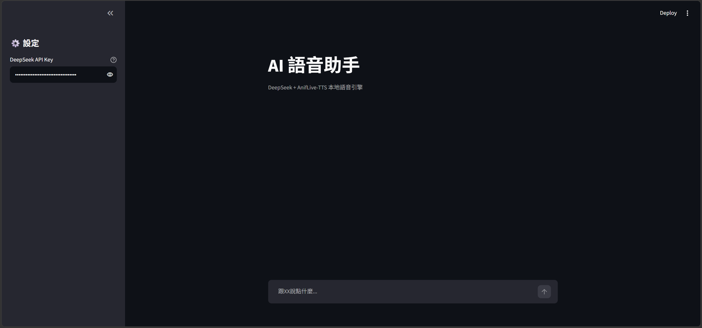

# 基於 AnifLive-TTS 與 DeepSeek 的文本語音聊天助手 (Text-to-Speech AI Chatbot)
> 非商業專案。基於 AnifLive-TTS（PolyForm Noncommercial 1.0.0）。
> 目前僅支援文字輸入，輸出為文字 + 語音；目前不含 ASR。
>
> 本專案為 AnifLive-TTS 的衍生專案。上游原始說明文件已保留於 README_UPSTREAM.md（及相關語系檔案）。



## 關於項目

在探索「文字輸入 → AI 回覆 → 語音播放」的聊天助手時，我發現原生／未經加速的 GPT-SoVITS 推理在部分場景下延遲較高。在尋找兼顧低延遲與高音質的方案時，我發現了由 Hiruynk 開源的 [AnifLive-TTS](https://github.com/Hiruynk/AnifLive-TTS)。

本專案以 AnifLive-TTS 的 TensorRT 加速引擎為基礎，串接 DeepSeek 大型語言模型，並使用 Streamlit 開發 Web UI，打造一個 「文字輸入、AI 生成回覆並以語音播放」 的聊天助手。Web UI 與 TTS 推理在本機運行，LLM 回覆則透過 DeepSeek API 生成。


## ⚠️ 授權與使用限制 (License & Restrictions)

本專案基於 [AnifLive-TTS](https://github.com/Hiruynk/AnifLive-TTS) 進行二次開發。
- 原專案 Copyright 2026 Hiruynk，依 PolyForm Noncommercial 1.0.0 授權（完整條款見根目錄 [`LICENSE`](LICENSE)）
- 本專案僅限非商業用途，商業使用需取得上游授權。
- 本專案對原專案之底層修改（`service.py`, `export_onnx.py` 等）皆已保留原版權聲明。
因此，**本項目僅限非商業、學術研究與個人測試用途**。任何商業使用需自行取得上游項目授權。DeepSeek API 的使用另受其服務條款約束。


## 🚀 本地適配與整合亮點 (Key Features & Patches)

為了讓此專案能在我的硬體設備上穩定運行，我進行了以下整合與環境適配：

*   **LLM 與 TTS 整合**：串接 DeepSeek API，設計 System Prompt 讓 LLM 動態輸出情緒標籤（如 `[joy-1]`），並透過 Regex 解析後傳遞給 TTS 引擎。
*   **顯存限制適配**：修改 `service.py`，將預設的 8GB VRAM 限制降低至 4GB，在 RTX 3060 Laptop (6GB) 上實測可運行 API（未驗證高併發與長音頻極限）。
*   **轉換流程相容性補丁**：針對本地 TensorRT 轉換遇到的驗證崩潰與精度不匹配，加入 `converter.py` 與 `export_onnx.py` 的本地轉換補丁，強制 FP32 轉型以打通流程（可能帶來細微精度差異）。
*   **Windows 環境防崩潰**：重構 `korean.py` 與 `streaming.py`，繞過對 C++ 套件（MeCab/G2P）的依賴，避免在 Windows 缺失依賴時啟動崩潰（註：此為功能降級，韓語發音將無法使用）。
*   **Web UI 開發**：使用 Streamlit 開發介面，支援側邊欄輸入 API Key、對話歷史記錄與語音自動播放。


## 📁 本專案新增與整合的檔案

本專案 Fork 自 AnifLive-TTS，保留了上游完整的底層架構，並在以下位置進行了修改或新增：

* `web_ui_app.py`：Streamlit 聊天介面主程式。
* `run_webui.bat`：Windows 一鍵啟動腳本。
* `th_deepseek.py`：DeepSeek API 串接與情緒標籤處理。
* `requirements.txt`：新增了 Streamlit 與 API 請求所需的依賴。

> 💡 **關於底層修改**：本專案對上游的顯存限制、TensorRT 轉換腳本及 Windows 依賴問題進行了修補。相關修改已散佈於 `service.py`、`converter.py`、`export_onnx.py`、`korean.py` 等檔案中，並皆已保留原版權聲明。

## 🛠️ 安裝與運行 (Quick Start)

### 1. 環境需求
* Windows / Linux
* Python 3.10+
* NVIDIA GPU (建議 6GB 以上顯存)
* 已配置好的本地 AnifLive-TTS API (運行於 Port `9882`)

### 2. 安裝依賴
```bash
pip install -r requirements.txt
```
### 3. 啟動 AnifLive-TTS 的 API
本專案的語音合成依賴本地運行的 AnifLive-TTS 服務。請先確保你的環境已準備好模型與 TensorRT 引擎。

詳細的安裝、Docker 部署與模型轉換步驟，請參考本倉庫保留的上游文檔：
👉 [AnifLive-TTS 部署指南 (繁體中文)](docs/DEPLOYMENT_ZH.md)
👉 [AnifLive-TTS 安裝指南 (Installation)](docs/INSTALLATION_ZH.md)

啟動後，請確保本地 API 已成功運行於 `http://127.0.0.1:9882`。

### 4. 啟動 Web UI
請確保 AnifLive-TTS 的 API 已經在背景啟動，然後執行：

* **Windows**: 雙擊 `run_webui.bat`
* **手動啟動**: `streamlit run web_ui_app.py`

打開瀏覽器進入 http://localhost:8501，在左側欄輸入你的 DeepSeek API Key 即可開始對話。


## ⚠️ 已知限制 (Known Limitations)
* 無語音輸入：目前僅支援文字輸入。
* 非商業用途：受上游 PolyForm Noncommercial 許可證限制。
* 硬體限制：專案基於 6GB 顯存環境優化，高併發場景尚未測試。
* 韓語功能缺失：為了解決 Windows 依賴問題，已移除韓文特徵提取功能。

## 🙏 致謝 (Acknowledgments)

* [AnifLive-TTS](https://github.com/Hiruynk/AnifLive-TTS) - 提供極致低延遲的 TTS 推論引擎。
* [GPT-SoVITS](https://github.com/RVC-Boss/GPT-SoVITS) - 開源語音克隆模型的基石。
* [DeepSeek](https://www.deepseek.com/) - 提供強大的 LLM API。
* 各大提供 GPT-SoVITS 模型的訓練者 - 感謝您們開源優質的語音模型與數據集，讓本地語音克隆技術得以實現。
